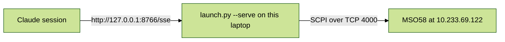

# tek-mso5-live

## Summary
- Connects Claude to the **real Tektronix MSO58** at `10.233.69.122` (socket server, port 4000).
- CH1 is clipped to the probe-comp terminal (1 kHz square wave, about 2.5 V).
- Claude can read measurements and the trace, change V/div and s/div, and start or stop acquisition.
- The simulated version is separate, in `~/mhs_setups/tek-scope-afg-demo` (port 8765).

## Status (as of 2026-10-20)
| Slot | Status | Evidence |
|---|---|---|
| scope/meas_frequency | live | 1000.16 Hz from the scope's MEAS1 |
| scope/meas_vpp | live | 2.67 V from the scope's MEAS2 |
| scope/ch1_trace | live | 1000 points, -0.08 to 2.52 V |
| scope/idn | live | `TEKTRONIX,MSO58,Q100104,CF:91.1CT FV:2.12.5.2206` |
| scope/link_error | live | empty when healthy (an extra diagnostic slot) |
| scope/horizontal_scale | live | write confirmed by a separate scope query; a 50 ms write was refused |
| scope/ch1_scale | live (read) | reads 1.0 V/div; no write tested |
| scope/run | live | start confirmed by the scope; emergency stop confirmed by the scope and seen by the operator |

## Files
| File | What it does | Edit it to |
|---|---|---|
| `setup.yaml` | Every control and reading with its limits | Change limits or add slots |
| `rig_target.py` | The real scope driver (SCPI over TCP) | Change the IP, add commands |
| `launch.py` | Starts everything (from the plugin; don't edit) | - |
| `serve.log` / `serve.pid` | Startup log and process ID | - |

## Start / stop / check (Git Bash)
- Python: reuses `~/mhs_setups/tek-scope-afg-demo/.venv` (SDK 7c3f1d9e, bridge 0e26ea7).
- Start (tested): `cd ~/mhs_setups/tek-mso5-live && nohup ../tek-scope-afg-demo/.venv/Scripts/python.exe launch.py --serve --estop-drill --port 8766 > serve.log 2>&1 & echo $! > serve.pid`
  - The startup drill **stops the scope**. Restart acquisition through Claude (`scope/run` = 1) or with the Run button.
- Health check (tested): `curl -s -o /dev/null -m 2 -w "%{http_code}\n" http://127.0.0.1:8766/sse` (expect `200`)
- Stop (tested): `kill $(cat serve.pid)`
- Connect Claude (untested): `claude mcp add --transport sse tek-mso5-live http://127.0.0.1:8766/sse`, then start a new session.
- Emergency stop: the bridge's `emergency_stop` tool stops acquisition. It stays latched until you stop and start the program again.

## Safety table
| Slot | Hardware limit | Allowed | On disconnect / stop |
|---|---|---|---|
| scope/ch1_scale | 0.0005-10 V/div | 0.01-5 V/div | HOLD (keeps value) |
| scope/horizontal_scale | 200 ps-1000 s/div | 1 us-10 ms/div | HOLD (keeps value) |
| scope/run | 0-1 | 0-1 | ZERO (stops acquiring) |

- No interlocks (your choice).

## How the driver works
- A background thread asks the scope for readings about every 2 s. That's slow because the record length is 1.25 M points (you chose to keep it).
- The driver thins the record to 1,000 evenly spaced points. The scope's own Freq and Pk-Pk measurements are not changed.
- Control writes are queued and sent by that same thread, so the stop never waits behind a trace download.
- Readings show NaN (and `scope/link_error` shows the cause) when the scope has no result or the link drops. They never show stale values.
- On first connect the driver added MEAS1 (Frequency, CH1) and MEAS2 (Pk-Pk, CH1) on the scope. It reuses them after that.

## Trade-off you accepted
- One program holds both the scope link and Claude's connection (no extra install). If that program crashes, nothing stops the scope automatically. For a scope, the worst case is that it keeps acquiring.

## Open TODOs
- `scope/ch1_scale` write not exercised.
- The Tek socket server handles a second client poorly. Avoid other programs querying port 4000 while this runs. If it stops answering, toggle Utility > I/O > Socket Server off and on.
- `claude mcp add` registration not tested.

## Troubleshooting
- Healthy log: `VERIFY DONE failures=0` (twice), `drill failures=0`, then `SERVING`.
- "quarantined from the MCP surface" lines are expected. Slots with `/` in the name aren't turned into per-slot tools, but `read_slots` and `write_slots` work.
- `EXPIRED ... policy applied` warnings mean the poll stalled for over 2 s and the scope was stopped. Check `scope/link_error`.
